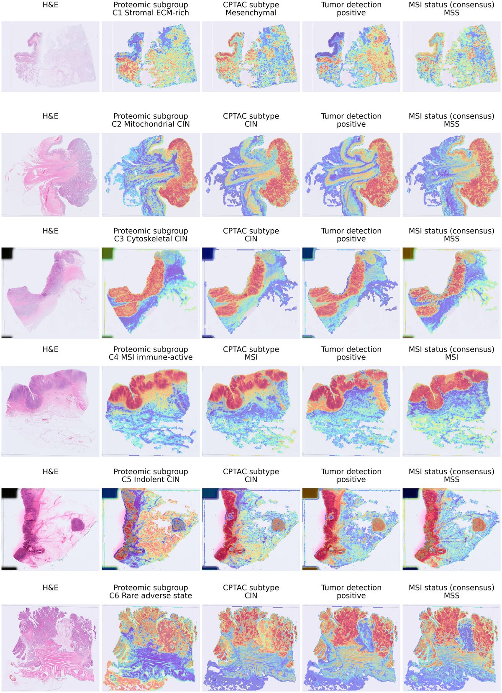

# CancerScout colon: whole-slide image benchmarks

Code for the whole-slide image (WSI) analyses of *A proteogenomic resource of 1,000 colorectal
cancers resolves functional tumor states* (Qoku\*, Ullrich\*, Miranda\* et al.): weakly supervised
classification of H&E slides with CLAM and three frozen tile encoders (ResNet50, UNI, CONCH) on the
discovery cohort, and transfer of the trained models, without retraining, to the public CPTAC-COAD
cohort.

It reproduces the WSI panels of the paper (Fig. 5D-F, Extended Data Figs 9 and 10, Supplementary
Figs 8 and 9) and Supplementary Table 6. `docs/REPRODUCE.md` maps every panel and table to the
script and inputs that produce it; `docs/METHODS.md` describes the methods as implemented.

## Approach

Each slide is cut into tissue tiles at 20x, every tile is embedded by a frozen encoder, and a
CLAM-MB model learns the slide-level label from the bag of tile embeddings alone: no tile-level
annotation is used. The model's attention shows which regions drive each prediction.



*Supplementary Fig. 8. Attention maps of the CONCH models on held-out discovery-cohort slides, one
slide per proteomic subgroup (rows, C1-C6). Left: H&E; then one map per task (proteomic subgroup,
CPTAC subtype, tumor detection, MSI status), titled with the slide's true label. Warm colors: high
attention.*

## Data and model availability

| What | Status | Where it goes |
|---|---|---|
| Discovery cohort (CancerScout colon) H&E slides and labels | Deposited in the BioImage Archive, released on publication | `data/cancerscout/` (empty until then; layout in its README) |
| CPTAC-COAD H&E slides (372 SVS, 66.7 GB) | Public, TCIA, doi:10.7937/TCIA.YZWQ-ZZ63 | `data/cptac/slides/`, via `scripts/00_download_cptac.sh` |
| CPTAC-COAD labels (MSI status, UMS subtype) | In this repository | `configs/cptac_labels/` |
| Trained CLAM models and StainNet | Not released | `models/` (layout in its README) |
| UNI and CONCH encoder weights | Gated on Hugging Face (MahmoodLab) | set `UNI_CKPT_PATH`, `CONCH_CKPT_PATH` |

## Install

```bash
conda env create -f environment.yml && conda activate clam_latest
# exact versions of the analysis environment: requirements-lock.txt
cp configs/paths.env.example configs/paths.env   # encoder weights; optional path overrides
```

The CPTAC download uses the IBM Aspera CLI: `gem install aspera-cli && ascli config transferd install`
(Ruby 3.2 or later). See `data/cptac/README.md` for a browser alternative.

## Run

Every step is a script in `scripts/`, run in order; `GPU` selects the device (default 0) and
`ENCODERS` a subset of `resnet uni conch`. Outputs go to `work/` (or `$CSWSI_WORK`): tiles,
features, splits, predictions (`work/eval_results/`), tables (`work/tables/`) and figures
(`work/figures/`, PDF and PNG).

**CPTAC-COAD only** (public data plus trained models in `models/`):

```bash
GPU=0 bash scripts/run_cptac.sh
```

downloads and verifies the slides, tiles them, embeds them at 20x (raw and StainNet), applies the
ten models of every endpoint evaluated on CPTAC, and writes the CPTAC tables (raw vs StainNet tests,
agreement, threshold transfer) and panels (Fig. 5F, Extended Data Fig. 10B-D, Supplementary Fig. 9).

**Full study** (needs the discovery-cohort release in `data/cancerscout/`):

```bash
GPU=0 bash scripts/run_all.sh
```

| Step | Script | Needs | Output |
|---|---|---|---|
| CPTAC download | `00_download_cptac.sh` | Aspera CLI | 372 SVS, checked against `configs/cptac_manifest.tsv` |
| Tissue tiling | `01_patch.sh` | slides | 256 px tiles: discovery cohort at 20x (level 1), CPTAC at level 0 (CLAM) |
| Tile embeddings | `02_features.sh` | discovery cohort | ResNet50 (ImageNet), UNI, CONCH; frozen, 224 px input |
| Cross-validation draws | `03_splits.sh` | discovery labels | ten train/validation/test draws inside each training set |
| Training | `04_train.sh` | discovery cohort | CLAM-MB, ten models per endpoint and encoder, in `models/clam/` |
| Held-out evaluation | `05_eval_heldout.sh` | discovery cohort, models | predictions on the patient-level held-out set; per-model thresholds |
| StainNet | `06_stainnet.sh` | CPTAC, three discovery reference tiles | `models/stainnet/stainnet_final.pt` |
| CPTAC tiles at 20x | `07_cptac_features_20x.sh` | CPTAC, StainNet | 512 px level-0 crops (the training field of view), raw and StainNet |
| CPTAC evaluation | `08_eval_cptac.sh` | models | frozen models, no retraining, no threshold recalibration |
| Metrics and tables | `09_metrics.sh` | predictions | per-model and ten-model metrics, raw vs StainNet tests, Supplementary Table 6 |
| Figures | `10_figures.sh` | tables (ED Fig. 10A: slides, features) | Fig. 5E,F; Extended Data Figs 9A-D, 10A-D |
| Attention maps | `11_heatmaps.sh` | models, features, slides | Fig. 5D; Supplementary Figs 8, 9 |

Each step checks its inputs and names the README to read when one is missing.

### From slides to trained models

The training part of the pipeline, step by step (discovery cohort; `GPU` and `ENCODERS` as above):

```bash
COHORTS=cancerscout bash scripts/01_patch.sh  # tissue mask, 256 px tiles at 20x -> work/patches/cancerscout/
bash scripts/02_features.sh                   # frozen tile embeddings -> work/features/cancerscout/<encoder>/
bash scripts/03_splits.sh                     # ten train/validation/test draws per endpoint, inside train.csv -> work/splits/
bash scripts/04_train.sh                      # CLAM-MB, ten models per endpoint and encoder -> models/clam/
bash scripts/05_eval_heldout.sh               # every model on the held-out set (eval.csv); per-model thresholds
```

The endpoints are the rows of `configs/endpoints.tsv`; remove rows to train a subset. Training
settings are in `scripts/04_train.sh` and `docs/METHODS.md`. A retrain follows the paper's
procedure but does not give bit-identical models, because GPU training is not deterministic.

## Layout

```
analysis/             metrics, majority vote, thresholds, raw vs StainNet tests, Supplementary Table 6
cancerscout/          discovery-cohort tiling
clam/                 CLAM (Lu et al. 2021), the fork used for this study (GPL-3.0)
configs/              endpoints, CPTAC labels and file manifest, example slides, path template
cptac/                CPTAC tile embeddings at the matched 20x field of view
data/                 cancerscout/ (placeholder until the data release), cptac/ (download target)
docs/                 METHODS.md, REPRODUCE.md
figures/              one script per figure panel
models/               trained models (not released; layout in models/README.md)
scripts/              the pipeline, in order (00-11), and the run_cptac.sh / run_all.sh drivers
stain_normalization/  StainNet and its fixed-statistics Macenko teacher
cswsi_config.py       every path the Python code reads or writes
```

## License

GPL-3.0 (see `LICENSE`), because the pipeline builds on CLAM. Third-party components, data and
model weights keep their own licenses; see `NOTICE.md`.

## Citation

Qoku\*, Ullrich\*, Miranda\* et al. A proteogenomic resource of 1,000 colorectal cancers resolves
functional tumor states. (In preparation.) Archived version of this code: DOI to be added.

When using the CPTAC-COAD data, cite the TCIA collection (doi:10.7937/TCIA.YZWQ-ZZ63) with the CPTAC
acknowledgment given on the collection page.
